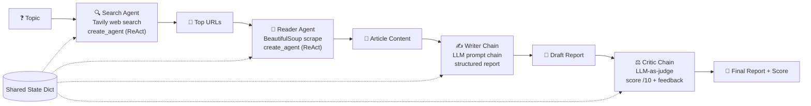

# 🧠 ResearchMind — Multi-Agent Research Assistant

Type any topic. Four AI stages — search, read, write, critique — collaborate to produce a scored research report.

## ✨ Features

- Topic in, scored research report out — intro, findings, conclusion, sources
- Two tool-calling agents (ReAct) + two deterministic LLM chains in one pipeline
- LLM-as-judge critic scores every report /10 with strengths and improvements
- Streamlit UI with live stage tracking and report download
- CLI mode for quick terminal runs

## 🏗️ Architecture



A shared state dictionary carries data between stages — each stage reads what the previous one wrote. No LangGraph state machine needed at this scale.

## 📁 Project Structure

```
├── app.py               # Streamlit web UI — live stage tracking, report download
├── pipeline.py          # Core pipeline: runs the 4 stages in order
├── pipeline_terminal.py # CLI version — ask from the terminal
├── agents.py            # Two create_agent tool-calling agents + writer/critic chains
├── tools.py             # The two tools: web_search (Tavily), scrape_url (BeautifulSoup)
├── config.toml          # App configuration (theme/settings)
└── requirements.txt
```

## 🚀 Quickstart

```bash
pip install -r requirements.txt
```

Create a `.env` file (never commit this):

```
OPENAI_API_KEY=your-key-here
TAVILY_API_KEY=your-key-here
```

**Web UI:**

```bash
streamlit run app.py
```

**Terminal:**

```bash
python pipeline_terminal.py
```

## 🧠 Design Decisions

| Choice | Why |
|---|---|
| **Agents for search & read, chains for write & critique** | Agents decide and act — the search path is unknown upfront (which URLs are worth reading?). Writing and critiquing follow a fixed prompt, so deterministic chains are cheaper and more predictable. |
| **`create_agent` (ReAct under the hood)** | Thought → Action → Observation loop: the LLM decides when to call a tool, sees the result, and decides the next step on its own. |
| **Shared state dict** | A plain dictionary is enough to pass data through a linear 4-stage pipeline — no framework overhead. |
| **LLM-as-judge critic** | A second model scoring the first model's output closes the loop: every report ships with a /10 score, strengths, and concrete improvements. |
| **temperature = 0** | Research reports must be factual and consistent — zero temperature removes creative drift. |
| **Character limits on scraped content** | Full articles are huge; truncating scraped text controls token cost per run. |
| **Tavily for search** | Built for LLMs — returns clean, relevant snippets instead of raw search-engine HTML. |
| **User approval before tool calls** | The agent asks before acting, so no surprise API calls or scraping. |

## 🛠️ Tech Stack

Python · LangChain (`create_agent`) · OpenAI (GPT-4o-mini) · Tavily · BeautifulSoup4 · Streamlit · Python-dotenv

## 📌 Improvements over the reference build

- Reader scrapes the top **3 URLs** instead of 1, for richer reports
- User approval step before the agent calls tools

*(Edit these two lines to match exactly what you built.)*
